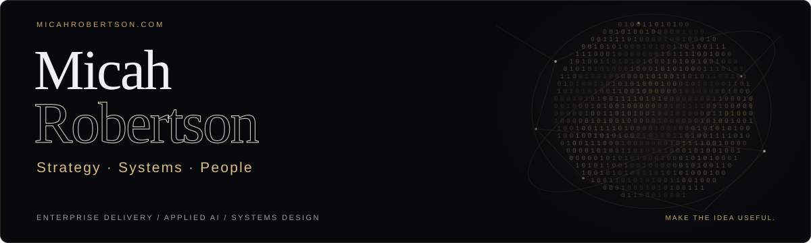

  <a href="https://micahrobertson.com"><b>WEBSITE</b></a> &nbsp; / &nbsp;
  <a href="https://micahrobertson.com/#explore"><b>SELECTED WORK</b></a> &nbsp; / &nbsp;
  <a href="https://www.linkedin.com/in/micahrobertson"><b>LINKEDIN</b></a>

### Make the idea useful.

I work where business strategy, people, and technology meet. I lead complex initiatives from the first conversation through delivery, and build tools that help people make better decisions and get work done.

My current work explores practical AI: how to evaluate it, how to work with it, and how to build systems that stay useful once the demo is over.

### Selected work

| Project | What it's for |
| :--- | :--- |
| **[Rust RAG](https://github.com/skigsy/rust-rag)** | A native Rust foundation for retrieval and Graph RAG, from Obsidian notes to private team search with source citations. |
| **[BFB Index](https://micahrobertson.com/#bfb)** | Finding the balance between AI performance and affordability. A practical way to compare what you get for what you spend. |
| **[Artificial Intent](https://micahrobertson.com/#architectingagency)** | My book on working deliberately with AI: the decisions, structures, and human judgment around the technology. |
| **[micahrobertson.com](https://micahrobertson.com)** | The home for my work, writing, and approach to strategy, systems, and people. |

### How I work

**Start with a shared goal.** Make the constraints and tradeoffs clear enough for a team to act.

**Design for how people work.** Account for trust, incentives, and the decisions people make every day.

**Stay through delivery.** A framework earns its place by improving a decision, a plan, or the product itself.

---

12+ years delivering · 20+ enterprise engagements · 10+ industries MBA, Rice University · BBA, Management Information Systems · PMP · PMI-ACP · PSM II · PSPO II · Lean Six Sigma Black Belt

 

**Have a difficult project or a system that needs untangling? [Let's talk.](https://micahrobertson.com/#connect)**
